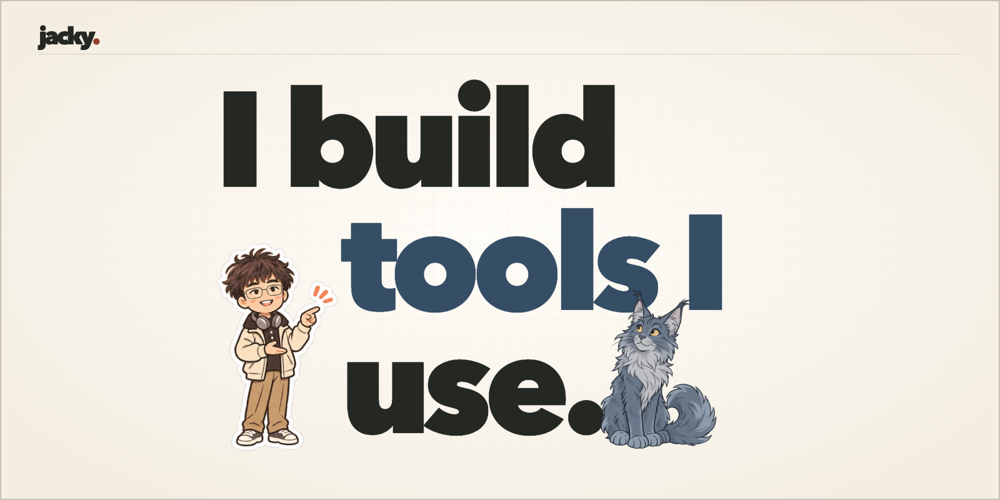
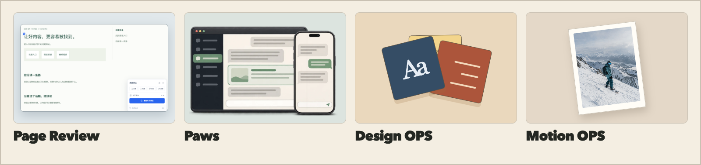

# Jacky 主站

<a href="https://jacky.paws.rodeo/"></a>

我把日常工作中反复遇到的问题做成工具，也把解法和验证过程记下来。

[打开主站](https://jacky.paws.rodeo/) · [看作品](https://jacky.paws.rodeo/#work) · [读笔记](https://jacky.paws.rodeo/#notes)

## 作品

<a href="https://jacky.paws.rodeo/#work"></a>

- **Page Review** — 在网页上圈出要改的地方，把位置、评注和截图一起交给 AI。[打开工具](https://page-review.paws.rodeo/)
- **Paws** — 用手机接续电脑上的 AI 会话，协作改稿时还能查看和恢复历史版本。[查看项目](https://github.com/wangjs-jacky/happy)
- **Design OPS** — 整理做过的风格、页面结构和交互，方便下次找例子和验收。[逛设计风格库](https://design.paws.rodeo/)
- **Motion OPS** — 按场景找可试用的网页动效和提示词，试试封面原位展开成详情。[打开 Motion Atlas](https://motion.paws.rodeo/motion-atlas/)

## 本地预览

在仓库根目录运行，再打开 [http://127.0.0.1:8000/](http://127.0.0.1:8000/)。站点文件都在 [`site/`](site/)。

```sh
python3 -m http.server 8000 --bind 127.0.0.1 --directory site
```
